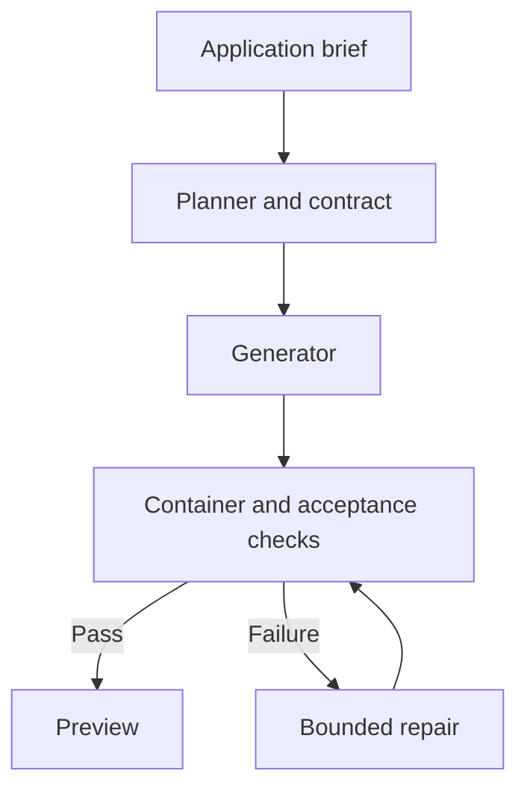
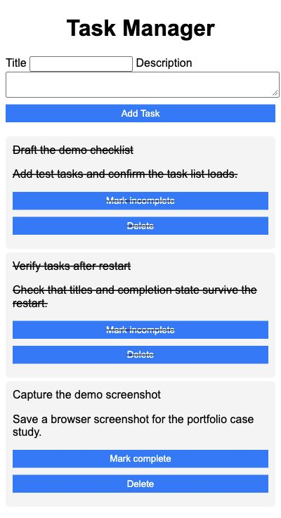

# Intelligent Productivity Suite

This local Python project turns an application brief into a contract, uses an Ollama-backed generator, and checks the generated application in a Docker execution environment. The repair loop uses acceptance failures to guide bounded retries. The preview follows acceptance checks.

## Demonstration

The deterministic test fixture uses a synthetic task manager with the requirement “Persist tasks.” It preserves the requirement, checks a five-route contract including HTTP 201 for creation and 204 for deletion, checks repeatability, and rejects an incomplete specification.

With authorized repository access, run `python -m unittest discover -s tests -v` from the checkout root. On November 25, 2026, four contract tests passed at revision `c0fa7624df6c03e0a28af15494ad668b2accf60c`. The repository and its Actions logs require access.

## Task manager demo

[Try the browser demo](https://robbiecalvin.com/productivity-suite/). You can add, complete, and delete tasks. Changes are stored in your browser.

On November 25, 2026, I ran the task-manager workflow on Docker Desktop using deterministic Ollama responses. An injected defect failed an acceptance check, one scripted repair corrected it, and 28 backend and four Chromium checks passed.

In a separate run, I started the reference app with SQLite on a Docker volume, added three synthetic tasks, and restarted the container. The task IDs, titles, descriptions, and completion states matched before and after the restart.

## Engineering decision

Keep the contract and acceptance checks independent of model output so a repair attempt can be judged against the same requirements as the original implementation.

## Scope and next step

Docker verification used simulated Ollama responses. A complete run with a live model is still pending. The public demo exercises the task workflow using browser storage. The Docker restart test verifies the reference app’s SQLite persistence.

## Résumé summary

Developed a local AI-assisted application generation pipeline with explicit contracts, container execution, browser acceptance testing, and bounded repair.
