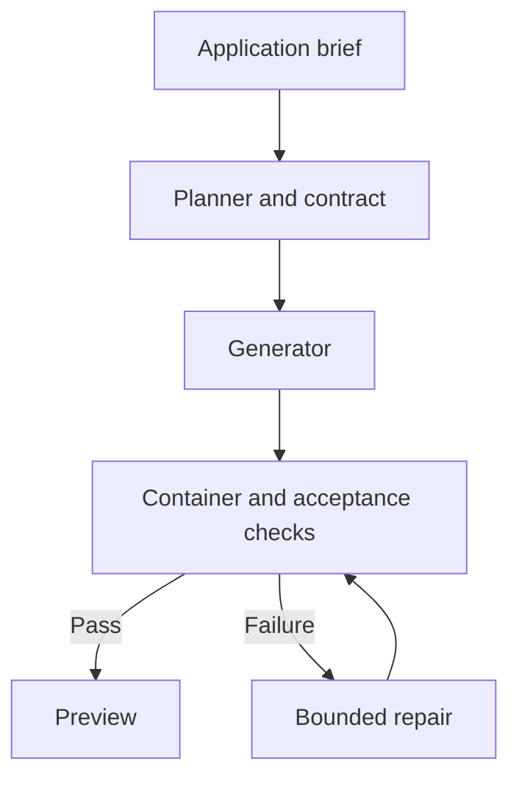

# Intelligent Productivity Suite

This local Python project turns an application brief into a contract, uses an Ollama-backed generator, and checks the generated application in a Docker execution environment. The repair loop uses acceptance failures to guide bounded retries. The preview follows acceptance checks.

## Demonstration

The deterministic test fixture uses a synthetic task manager with the requirement “Persist tasks.” It preserves the requirement, checks a five-route contract including HTTP 201 for creation and 204 for deletion, checks repeatability, and rejects an incomplete specification.

With authorized repository access, run `python -m unittest discover -s tests -v` from the checkout root. On November 25, 2026, four contract tests passed at revision `c0fa7624df6c03e0a28af15494ad668b2accf60c`. The repository and its Actions logs require access.

## Engineering decision

Keep the contract and acceptance checks independent of model output so a repair attempt can be judged against the same requirements as the original implementation.

## Scope and next step

The verified run did not execute a live model, a container, or a generated application. The next evaluation is to rerun the task-manager and expense-tracker scenarios with a pinned model and record acceptance outcomes before and after repair.

## Résumé summary

Developed a local AI-assisted application generation pipeline with explicit contracts, container execution, browser acceptance testing, and bounded repair.
